

   

   

### 🪪 FILE 00 — SUBJECT DOSSIER

*Personnel file for Kunal Kushwaha, cybersecurity & network security student*


### 🗂️ SERVICE RECORD — FIELD POSTINGS

*Internships and campus work: CodeAlpha, InterSpark, EduSkills × AICTE, Techfest IIT Bombay*


### 🏆 COMMENDATIONS — THE RECORD SPEAKS

*Competition results and a graded virtual internship*


### 📋 THE CASE BOARD — INVESTIGATION DIRECTORY

*Network security, web assessments and security tools built so far*


    

### 🇮🇳 FILE 01 — BHARAT APP

**STATUS: ACTIVE INVESTIGATION** // Civic-safety and cybersecurity platform  
*Started at IgniteX HackFest 2026 and still being expanded.*


### 🔐 FILE 02 — EVIDENCE LOCKER (CTFs & Job Simulations)

*Capture-the-flag events and industry job simulations on record*


### 🗄️ FILE 03 — CREDENTIALS VAULT

*Certifications and workshops, with years*


### 🧰 FILE 04 — ISSUED FIELD ARSENAL & TOOLING

*Languages, platforms and security tooling*


### 📊 TELEMETRY — LIVE CODE METRICS

*Commit activity, streak and language distribution*

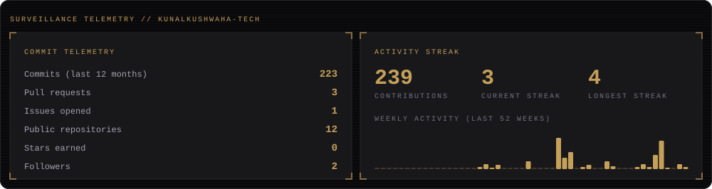

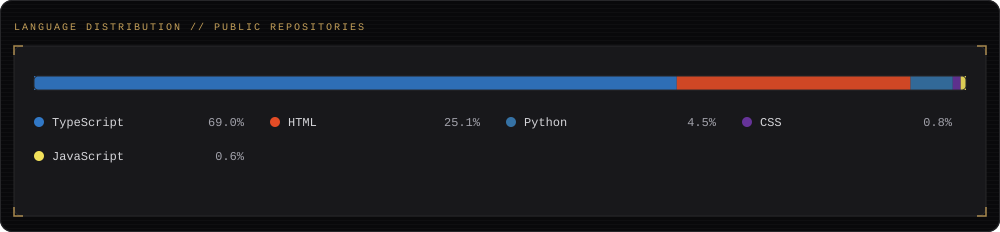

### 🎯 MISSION BOARD — CURRENT OBJECTIVES

*What is cleared and what is still open*


### 📮 DISPATCH CHANNELS — CONTACT

*Got a security problem, a project idea, or an opening? Reach out.*


   

